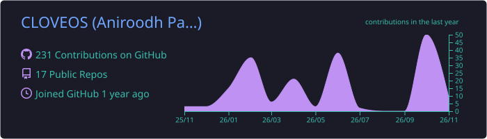
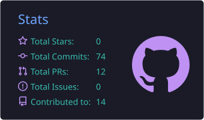
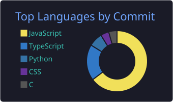

<h1 align="center">Hi, I'm Aniroodh Patil 👋</h1>
<h3 align="center">Full-stack developer · Backend & cloud enthusiast · Student</h3>

  

  
  

---

### 🧑‍💻 About me

- 🎓 Student who loves building **real, end-to-end products**, from the database to the phone screen
- ⚙️ Mostly backend: **REST APIs, auth, databases, event streaming and containers**
- 📱 Currently building **MiniLedger**, a lending tracker app (Expo + Express + PostgreSQL)
- ☁️ Exploring **cloud & big data**: Kafka, Spark, Docker, Kubernetes, Azure / GCP
- 🌱 Learning by shipping. Every repo here is something I built to understand how it really works

---

### 🛠️ Tech stack

   
   
   
  

---

### 🚀 Featured projects

| Project | What it is | Stack |
|---|---|---|
| **[CloudExec](https://github.com/CLOVEOS/cloudExec)** | Online code runner for Indian learners. Every run streams through Kafka → Spark into a personal skill profile, and errors are explained in 11 Indian languages with Sarvam AI | React · Express · Kafka · Spark · MongoDB · Docker sandboxes · Kubernetes · Prometheus |
| **[MiniLedger](https://github.com/CLOVEOS/projectHelper)** | Mobile app to track money lent to friends: loans, repayments, overdue alerts and a dashboard, with phone + email OTP sign-in | Expo / React Native · Express 5 · PostgreSQL · Drizzle · JWT |
| **[CoreIntegrator](https://github.com/CLOVEOS/CoreIntegrator)** | Dockerized ERP → CRM integration middleware with incremental sync, retries, batching and audit logs | Node.js · MySQL · Docker |
| **[BookMyShow Backend](https://github.com/CLOVEOS/MovieTicketsBookingSystems)** | Movie-ticket booking APIs for movies, venues, shows, artists and bookings | FastAPI · PostgreSQL · MongoDB |
| **[Blockchain DFS](https://github.com/CLOVEOS/decentralizedFileStorageSystem)** | Decentralized file storage: files on IPFS, CIDs stored on Ethereum (Sepolia) | Solidity · React · ethers.js · IPFS / Pinata |
| **[FriendZone Chat](https://github.com/CLOVEOS/ChatAsap---Realtime-Chat-Application)** | Realtime chat with friend requests and Google sign-in | Next.js · TypeScript · Redis · Tailwind |

<b>More projects</b>

| Project | What it is | Stack |
|---|---|---|
| [chatMate](https://github.com/CLOVEOS/chatMate) | Realtime chat with online status and JWT auth | MERN · Socket.io · Zustand |
| [codeSage](https://github.com/CLOVEOS/codeSage) | In-browser code editor | React · Monaco · Express |
| [cloudinaryUploader](https://github.com/CLOVEOS/cloudinaryUploader) | Image uploads to Cloudinary | React · Vite · Node.js |
| [E-commerce Platform](https://github.com/CLOVEOS/ECOMMERCE-PLATFORM-USING-NODE.JS) | Store with cart, orders and an admin panel | React · Redux · Express · MongoDB |
| [Auth API](https://github.com/CLOVEOS/AUTHENTICATION-AND-AUTHORIZATION-USING-NODE.JS) | Authentication boilerplate with protected routes and CSRF protection | Express · MongoDB |
| [Sentiment Analysis](https://github.com/CLOVEOS/sentimentAnalysis) | NLP pipeline using NLTK VADER with visual sentiment distributions | Python · NLTK |
| [Movie Rental System](https://github.com/CLOVEOS/movieRentalSystemUsingRawCpp) | Movie renting simulation with efficient search & reports | C++17 |
| [Iterative TCP Ticker](https://github.com/CLOVEOS/-Iterative-TCPTICKER) | TCP client–server time service with raw sockets | C |

---

### 📊 GitHub stats

<!-- These cards are generated daily by .github/workflows/profile-cards.yml and stored in this repo -->

  

  
  

  

---

### 🤝 Connect with me

  
  
  <!-- Add your links:
  <a href="https://www.linkedin.com/in/<your-handle>"></a>
  <a href="mailto:<your-email>"></a>
  -->

<i>"A little more clarity. A lot less remembering."</i>

